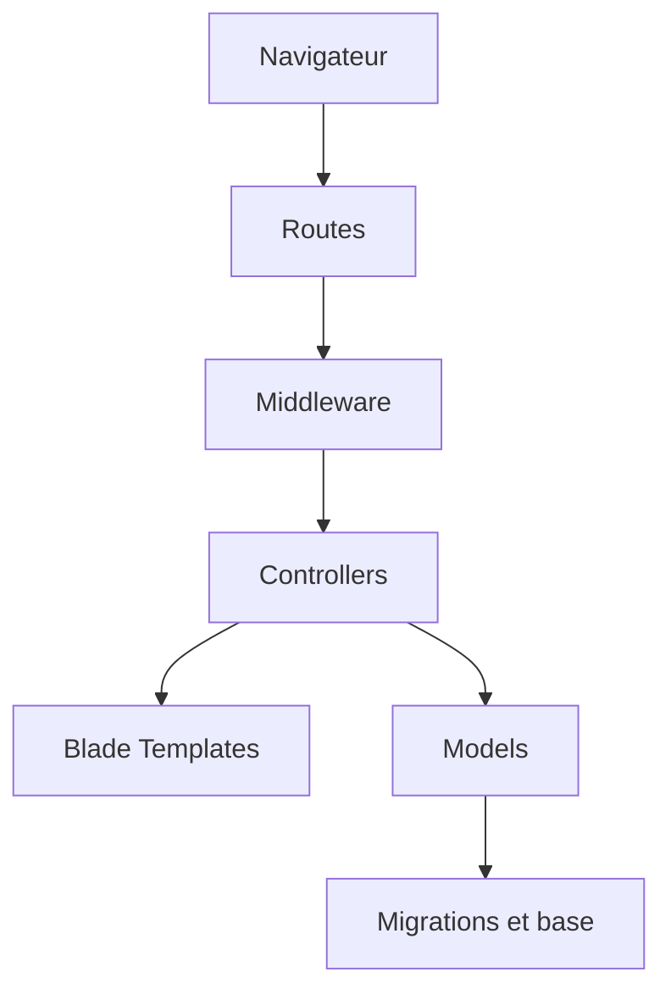

# LinkStackOrg/LinkStack

> Free, self-hosted link-page platform, a Linktree alternative, with an admin panel.

## The problem
Social networks allow only a single link, and link-page services keep your data.

## What it actually does
Laravel application serving one link page per user, with sign-up for other users and an admin panel. Themes are uploaded as zip files from the admin. A drag-and-drop installer exists, as well as a Docker image (Alpine, Apache, PHP 8.2) and an automatic update with backup.

## How it is wired


## Trying it
```bash
docker pull linkstackorg/linkstack
```

## Cost and gotchas
Free, self-hosted: you need a server or a PHP hosting plan. The README warns that the automatic update can fail silently if the PHP versions of the dependencies do not match. A MySQL database is not included in the backup.

## What it is not
Not a documented analytics or click-tracking tool. The free instances offered by the project remain a third-party service.

## Alternatives
- Linktree: the commercial offering this project replaces.

## For you
Ignore: a personal link page has no data, AI or MLOps use.
