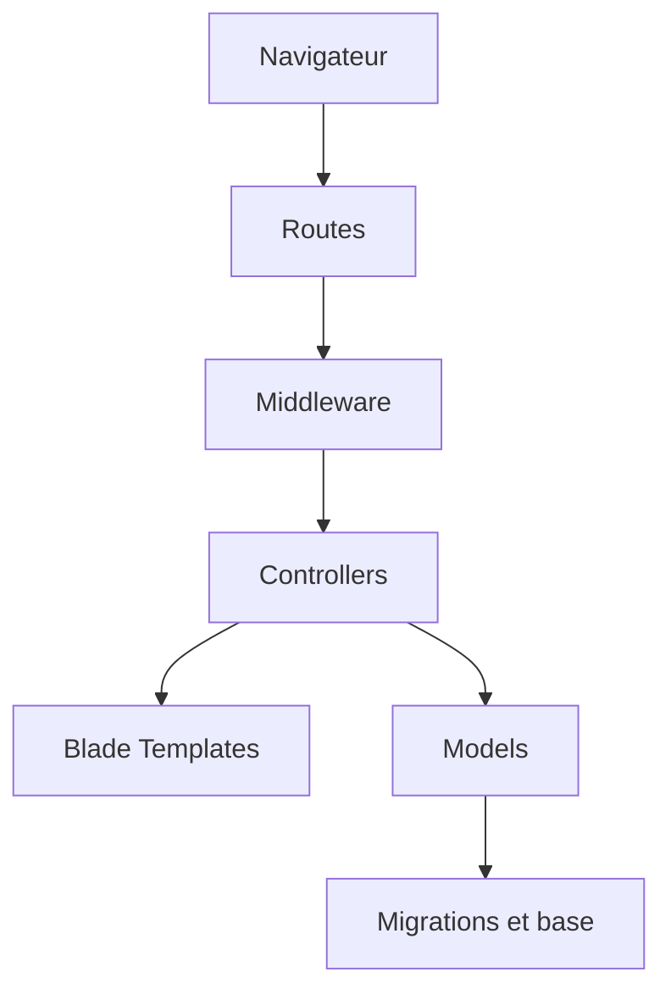

# LinkStackOrg/LinkStack

> Plateforme libre et auto-hébergée de page de liens, alternative à Linktree, avec panneau d'administration.

## Le problème
Les réseaux sociaux n'autorisent qu'un seul lien, et les services de page de liens gardent tes données.

## Ce que ça fait vraiment
Application Laravel qui sert une page de liens par utilisateur, avec inscription d'autres utilisateurs et panneau d'admin. Les thèmes se téléversent en zip depuis l'admin. Un installeur par glisser-déposer existe, ainsi qu'une image Docker (Alpine, Apache, PHP 8.2) et une mise à jour automatique avec sauvegarde.

## Comment c'est branché


## Essayer
```bash
docker pull linkstackorg/linkstack
```

## Coût et pièges
Gratuit, auto-hébergé : il te faut un serveur ou une offre d'hébergement PHP. Le README signale que la mise à jour automatique peut échouer sans erreur si les versions PHP des dépendances ne correspondent pas. Une base MySQL n'est pas incluse dans la sauvegarde.

## Ce que ce n'est pas
Pas un outil d'analyse ni de suivi de clics documenté. Les instances gratuites proposées par le projet restent un service tiers.

## Alternatives
- Linktree : l'offre commerciale que ce projet remplace.

## Pour toi
À ignorer : une page de liens perso n'a pas d'usage data, IA ou MLOps.

