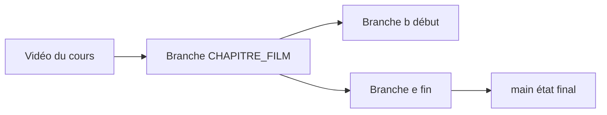

# LinkedInLearning/advanced-terraform-3099246

> Exercise files for the LinkedIn Learning course "Advanced Terraform", one branch per video.

## The problem
Following a video course without the exact code of each step makes the exercises hard to reproduce.

## What it actually does
Each video corresponds to a branch named `CHAPTER_VIDEO` (for example `02_03`), sometimes with a starting state `b` and a final state `e`. `main` contains the final state. The course covers variables, loops, modules, remote backend, multi-environments and a CI/CD pipeline.

## How it is wired
Simplified diagram based on the sheet, no diagram provided.



## Trying it
```bash
git add .
git commit -m "some message"
```
These commands are used to switch branches without losing your changes.

## Cost and gotchas
The course itself is on LinkedIn Learning, which requires a subscription. The repository has not moved since February 2024.

## What it is not
It is not a standalone tutorial: without the video, the repository explains nothing. The README does not say which Terraform version is used.

## Alternatives
No alternative named in the README.

## For you
Ignore: the content only makes sense with the paid course, the license is unclear and the repository is frozen.
