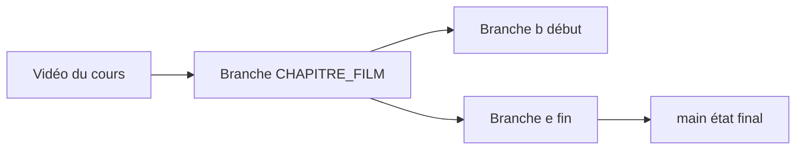

# LinkedInLearning/advanced-terraform-3099246

> Fichiers d'exercices du cours LinkedIn Learning « Advanced Terraform », une branche par vidéo.

## Le problème
Suivre un cours vidéo sans le code exact de chaque étape rend les exercices difficiles à reproduire.

## Ce que ça fait vraiment
Chaque vidéo correspond à une branche nommée `CHAPITRE_FILM` (par exemple `02_03`), avec parfois un état de départ `b` et un état final `e`. `main` contient l'état final. Le cours couvre variables, boucles, modules, backend distant, multi-environnements et un pipeline CI/CD.

## Comment c'est branché
Schéma simplifié d'après la fiche, sans diagramme fourni.



## Essayer
```bash
git add .
git commit -m "some message"
```
Ces commandes servent à changer de branche sans perdre ses modifications.

## Coût et pièges
Le cours lui-même est sur LinkedIn Learning, qui demande un abonnement. Le dépôt n'a pas bougé depuis février 2024.

## Ce que ce n'est pas
Ce n'est pas un tutoriel autonome : sans la vidéo, le dépôt n'explique rien. Le README ne dit pas quelle version de Terraform est utilisée.

## Alternatives
Aucune alternative nommée dans le README.

## Pour toi
Ignorer : le contenu n'a de sens qu'avec le cours payant, la licence est floue et le dépôt est figé.

