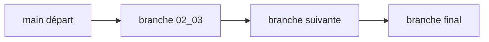

# LinkedInLearning/learning-terraform-3087701

> Companion repository for the LinkedIn Learning course "Learning Terraform", for beginners on AWS.

## The problem
Following a video course with the exact code of each step.

## What it actually does
One branch per video (`CHAPTER#_VIDEO#`, e.g. `02_03`): the code is built sequentially, `main` holds the starting point and `final` the finished version. The course shows how to set up AWS for Terraform, the basic commands and the registry modules.

## How it is wired

## Trying it
No command in the README: you switch branches per chapter.

## Cost and gotchas
AWS account required; resources created are on you. The LinkedIn Learning course itself is paid. Last push in August 2024, 150 open issues.

## What it is not
Not a standalone tutorial: without the video, little text. A license is present but not identified.

## Alternatives
No alternative named in the README.

## For you
Ignore: a beginner Terraform course tied to a subscription; useful only if you are already following the video.
