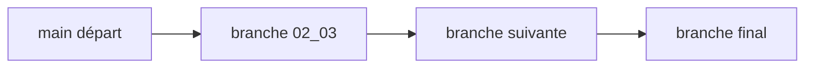

# LinkedInLearning/learning-terraform-3087701

> Dépôt d'accompagnement du cours LinkedIn Learning « Learning Terraform », pour débutants sur AWS.

## Le problème
Suivre un cours vidéo avec le code exact de chaque étape.

## Ce que ça fait vraiment
Une branche par vidéo (`CHAPITRE#_FILM#`, ex. `02_03`) : le code est construit séquentiellement, `main` contient le point de départ et `final` la version terminée. Le cours montre la configuration d'AWS pour Terraform, les commandes de base et les modules du registre.

## Comment c'est branché

## Essayer
Aucune commande dans le README : on change de branche par chapitre.

## Coût et pièges
Compte AWS requis ; ressources créées à ta charge. Le cours LinkedIn Learning lui-même est payant. Dernier push en août 2024, 150 issues ouvertes.

## Ce que ce n'est pas
Pas un tutoriel autonome : sans la vidéo, peu de texte. Licence présente mais non identifiée.

## Alternatives
Aucune alternative nommée dans le README.

## Pour toi
À ignorer : cours Terraform débutant adossé à un abonnement ; utile seulement si tu suis déjà la vidéo.

