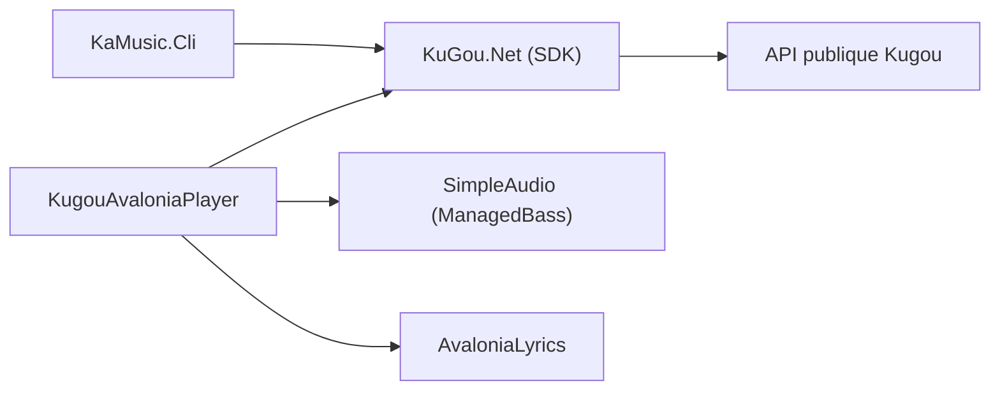

# Linsxyx/KugouMusic.NET

> Desktop music player (.NET and Avalonia) for Kugou, with floating lyrics, written in Chinese.

## The problem
Linux had no complete Kugou client; the author offers a lightweight, cross-platform one, without Electron.

## What it actually does
Desktop client for Windows, Linux and macOS: Kugou login, recommendations, charts, search, word-by-word lyrics, 10-band equalizer, local and Jellyfin import, import of NetEase and QQ playlists. The repository also includes a terminal player, a Kugou SDK and an ASP.NET Core web API.

## How it is wired
Simplified diagram based on the sheet, no diagram provided.



## Trying it
```bash
dotnet restore KugouMusic.NET.slnx
dotnet build KugouMusic.NET.slnx
dotnet run --project src/Apps/KugouAvaloniaPlayer/KugouAvaloniaPlayer.csproj
```

## Cost and gotchas
Free, but online playback requires a logged-in Kugou account. The macOS package is not signed. .NET 10 is required to build.

## What it is not
Not an official client: it relies on public APIs, with use limited to personal and research purposes according to the disclaimer. The README is in Chinese only.

## Alternatives
No alternative cited in the README.

## For you
Ignore: a consumer music player tied to a Chinese service, unrelated to data, AI or MLOps work.
