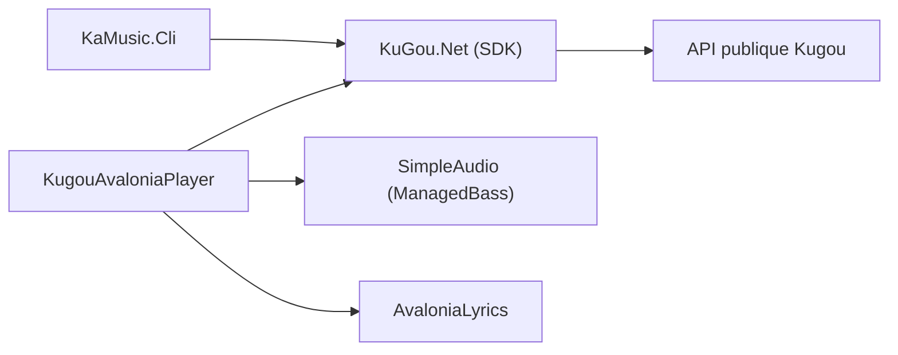

# Linsxyx/KugouMusic.NET

> Lecteur de musique de bureau (.NET et Avalonia) pour Kugou, avec paroles flottantes, rédigé en chinois.

## Le problème
Linux n'avait pas de client Kugou complet ; l'auteur en propose un léger et multiplateforme, sans Electron.

## Ce que ça fait vraiment
Client de bureau Windows, Linux et macOS : connexion Kugou, recommandations, classements, recherche, paroles par mot, égaliseur 10 bandes, import local et Jellyfin, import de listes NetEase et QQ. Le dépôt inclut aussi un lecteur terminal, un SDK Kugou et une API web ASP.NET Core.

## Comment c'est branché
Schéma simplifié d'après la fiche, sans diagramme fourni.



## Essayer
```bash
dotnet restore KugouMusic.NET.slnx
dotnet build KugouMusic.NET.slnx
dotnet run --project src/Apps/KugouAvaloniaPlayer/KugouAvaloniaPlayer.csproj
```

## Coût et pièges
Gratuit, mais la lecture en ligne exige un compte Kugou connecté. Le paquet macOS n'est pas signé. Il faut .NET 10 pour compiler.

## Ce que ce n'est pas
Pas un client officiel : il s'appuie sur des API publiques, usage limité au personnel et à la recherche selon l'avertissement. Le README n'est qu'en chinois.

## Alternatives
Aucune alternative citée dans le README.

## Pour toi
Ignorer : lecteur musical grand public lié à un service chinois, sans rapport avec un travail data, IA ou MLOps.

