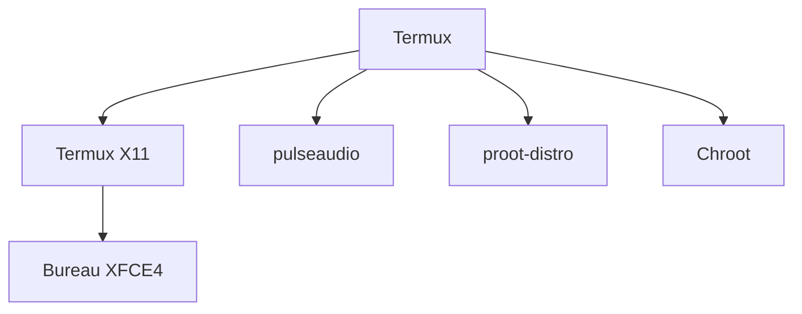

# LinuxDroidMaster/Termux-Desktops

> Scripts and guides to run a Linux desktop with audio on Android through Termux X11.

## The problem
Installing a full Linux desktop on an Android phone requires choosing between several methods and configuring everything by hand.

## What it actually does
A set of scripts and guides for three approaches: native Termux, proot-distro and chroot. It covers installing distributions (Alpine, Ubuntu, Debian, Arch, Kali NetHunter, Parrot OS and others), an XFCE4 desktop with audio and hardware acceleration. The author's YouTube videos accompany each step.

## How it is wired
Simplified diagram based on the sheet, no diagram provided.


## Trying it
```bash
pkg update
pkg upgrade
pkg install x11-repo
pkg install termux-x11-nightly
pkg install pulseaudio
pkg install proot-distro
```

## Cost and gotchas
Free. Chroot requires a rooted device; proot is slower. Performance remains modest on a phone.

## What it is not
Not a serious computing environment: the README itself points to Winlator for games. It does not replace a Linux workstation for data work.

## Alternatives
No alternative named in the README.

## For you
Ignore: useful for tinkering with a Linux desktop on Android, but of no interest for data, AI or MLOps work.
