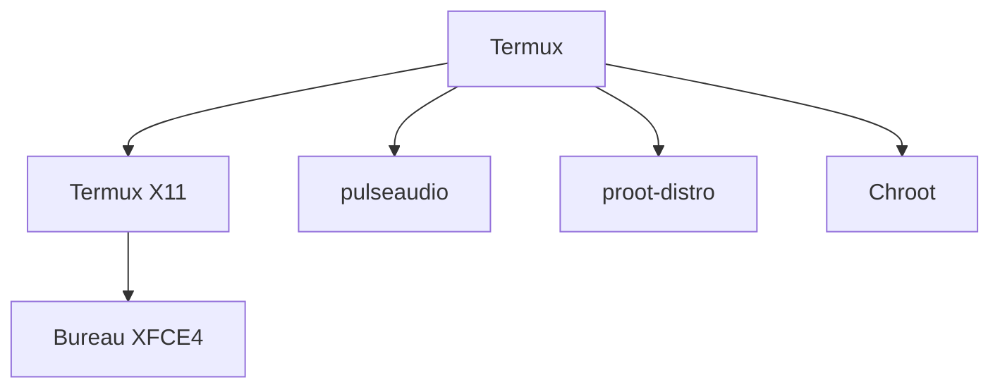

# LinuxDroidMaster/Termux-Desktops

> Des scripts et guides pour lancer un bureau Linux avec audio sur Android via Termux X11.

## Le problème
Installer un bureau Linux complet sur un téléphone Android demande de choisir entre plusieurs méthodes et de tout configurer à la main.

## Ce que ça fait vraiment
Un ensemble de scripts et de guides pour trois approches : Termux natif, proot-distro et chroot. Il couvre l'installation de distributions (Alpine, Ubuntu, Debian, Arch, Kali NetHunter, Parrot OS et d'autres), un bureau XFCE4 avec audio et l'accélération matérielle. Des vidéos YouTube de l'auteur accompagnent chaque étape.

## Comment c'est branché
Schéma simplifié d'après la fiche, sans diagramme fourni.


## Essayer
```bash
pkg update
pkg upgrade
pkg install x11-repo
pkg install termux-x11-nightly
pkg install pulseaudio
pkg install proot-distro
```

## Coût et pièges
Gratuit. Le chroot exige un appareil rooté ; proot est plus lent. Les performances restent modérées sur téléphone.

## Ce que ce n'est pas
Pas un environnement de calcul sérieux : le README lui-même renvoie vers Winlator pour les jeux. Il ne remplace pas un poste Linux pour faire du travail data.

## Alternatives
Aucune alternative nommée dans le README.

## Pour toi
À ignorer : utile pour bricoler un bureau Linux sur Android, mais sans intérêt pour un travail data, IA ou MLOps.

