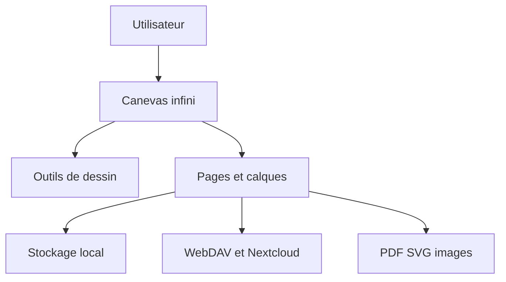

# LinwoodDev/Butterfly

> Free note-taking and drawing application on an infinite workspace.

## The problem
Linear notes limit diagrams, sketches and mixed documents.

## What it actually does
An infinite canvas with stylus writing, text and Markdown, shapes, images, PDF and SVG. Pages, layers, templates and export to PDF, SVG or images. Local storage, WebDAV or Nextcloud; experimental encrypted collaboration.

## How it is wired
Simplified diagram based on the sheet, no diagram supplied.



## Trying it
No command in the README: download or web version.
```bash
# non documenté : télécharger Butterfly ou ouvrir la web app
```

## Cost and gotchas
Free, no account or subscription. AGPL-3.0 license, to consider if you want to derive code from it.

## What it is not
Not a data or AI tool. Collaboration is experimental.

## Alternatives
No alternative named in the README.

## For you
Ignore for your data/AI work: a good note-taking app, but unrelated to your pipelines.
