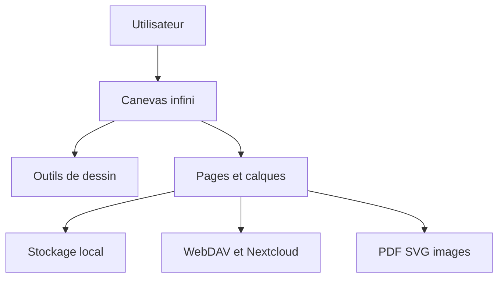

# LinwoodDev/Butterfly

> Application libre de prise de notes et de dessin sur un espace de travail infini.

## Le problème
Les notes linéaires limitent les schémas, croquis et documents mélangés.

## Ce que ça fait vraiment
Un canevas infini avec écriture au stylet, texte et Markdown, formes, images, PDF et SVG. Pages, calques, modèles et export PDF, SVG ou images. Stockage local, WebDAV ou Nextcloud ; collaboration chiffrée expérimentale.

## Comment c'est branché
Schéma simplifié d'après la fiche, sans diagramme fourni.



## Essayer
Aucune commande dans le README : téléchargement ou version web.
```bash
# non documenté : télécharger Butterfly ou ouvrir la web app
```

## Coût et pièges
Gratuit, sans compte ni abonnement. Licence AGPL-3.0, à considérer si tu veux en dériver du code.

## Ce que ce n'est pas
Pas un outil data ou IA. La collaboration est expérimentale.

## Alternatives
Aucune alternative nommée dans le README.

## Pour toi
À ignorer pour ton métier data/IA : bonne application de notes, mais sans lien avec tes pipelines.

