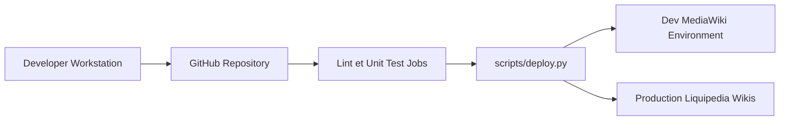

# Liquipedia/Lua-Modules

> Lua, JavaScript and SCSS modules that generate Liquipedia pages, for wiki contributors.

## The problem
Esports wikis need complex renderings (tables, brackets) that simple MediaWiki templates cannot provide.

## What it actually does
Monorepo with `lua/` (page logic), `javascript/` (interactivity) and `stylesheets/` (SCSS). After review, the modules are deployed to the wiki by `scripts/deploy.py` via the MediaWiki API, in a `/dev/` sandbox for testing. CI: lint, tests, visual snapshots, deployment. It is a subset of what runs on the site.

## How it is wired


## Trying it
```bash
git clone https://github.com/Liquipedia/Lua-Modules.git
# ouvrir dans VS Code, Reopen in Container
npm run lua-test
npm run test:js
```

## Cost and gotchas
Docker and devcontainer (~5 min on first build). A wiki bot account is required to deploy. A `deploy.py` run with no argument and no `LUA_DEV_ENV_NAME` resynchronizes everything on the production wiki.

## What it is not
Not usable outside Liquipedia: the modules assume their wiki. The license is present but not identified by GitHub.

## Alternatives
None cited in the README.

## For you
Ignore: tooling specific to an esports wiki, with no data, AI or MLOps use.
