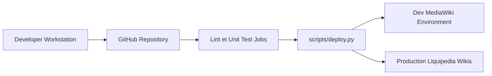

# Liquipedia/Lua-Modules

> Modules Lua, JavaScript et SCSS qui génèrent les pages de Liquipedia, pour contributeurs du wiki.

## Le problème
Les wikis esport ont besoin de rendus complexes (tableaux, brackets) que les modèles MediaWiki simples ne permettent pas.

## Ce que ça fait vraiment
Monorepo `lua/` (logique de page), `javascript/` (interactivité) et `stylesheets/` (SCSS). Après relecture, les modules sont déployés sur le wiki par `scripts/deploy.py` via l'API MediaWiki, en sandbox `/dev/` pour les tests. CI : lint, tests, snapshots visuels, déploiement. C'est un sous-ensemble de ce qui tourne sur le site.

## Comment c'est branché


## Essayer
```bash
git clone https://github.com/Liquipedia/Lua-Modules.git
# ouvrir dans VS Code, Reopen in Container
npm run lua-test
npm run test:js
```

## Coût et pièges
Docker et devcontainer (~5 min au premier build). Un compte bot du wiki est requis pour déployer. Un `deploy.py` sans argument ni `LUA_DEV_ENV_NAME` resynchronise tout sur le wiki en production.

## Ce que ce n'est pas
Pas utilisable hors de Liquipedia : les modules supposent leur wiki. La licence est présente mais non identifiée par GitHub.

## Alternatives
Aucune citée dans le README.

## Pour toi
Ignorer : outillage propre à un wiki esport, sans usage data, IA ou MLOps.

