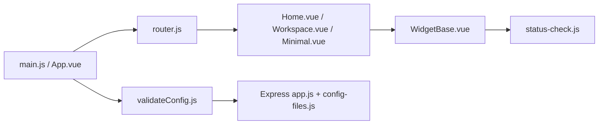

# Lissy93/dashy

> YAML-customizable dashboard for homelabs, with statuses, widgets and search.

## The problem
Self-hosted services multiply and you lose track of their URLs; you need a single home page that also shows whether they respond.

## What it actually does
A Vue application served with an Express server. The config is a `conf.yml` file (editable via the UI). It displays links, widgets, status indicators (HTTP and ping), multiple pages, themes and icons. Basic authentication or OIDC/Keycloak. Optional encrypted cloud backup (Cloudflare worker).

## How it is wired


## Trying it
```bash
docker run -p 4000:8080 lissy93/dashy
# avec config persistante
docker run -d -p 4000:8080 -v /path/to/your/user-data:/app/user-data --name my-dashboard --restart=always lissy93/dashy:latest
```

## Cost and gotchas
Free, ~256 MB of RAM. The mounted folder must contain at least a `conf.yml`. Cloud backup goes through a third-party service (optional).

## What it is not
Not a monitoring tool: statuses are a simple HTTP/ping test. Basic auth uses a SHA-256 hash in the config, not meant for public exposure without precautions.

## Alternatives
- Homer: more static, Apache-2.0.
- Heimdall: MIT.
- Flame: MIT.

## For you
Useful if you self-host MLflow, Grafana or Jupyter and want a portal; without a homelab, no interest for your work.
