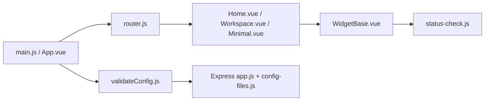

# Lissy93/dashy

> Tableau de bord personnalisable en YAML pour homelab, avec statuts, widgets et recherche.

## Le problème
Les services auto-hébergés se multiplient et on perd leurs URL ; il faut une page d'accueil unique qui montre aussi s'ils répondent.

## Ce que ça fait vraiment
Application Vue servie avec un serveur Express. La config est un fichier `conf.yml` (modifiable via l'UI). Elle affiche des liens, des widgets, des indicateurs de statut (HTTP et ping), plusieurs pages, thèmes et icônes. Authentification basique ou OIDC/Keycloak. Sauvegarde cloud chiffrée optionnelle (Cloudflare worker).

## Comment c'est branché


## Essayer
```bash
docker run -p 4000:8080 lissy93/dashy
# avec config persistante
docker run -d -p 4000:8080 -v /path/to/your/user-data:/app/user-data --name my-dashboard --restart=always lissy93/dashy:latest
```

## Coût et pièges
Gratuit, ~256 Mo de RAM. Le dossier monté doit contenir au moins un `conf.yml`. La sauvegarde cloud passe par un service tiers (optionnelle).

## Ce que ce n'est pas
Pas un outil de supervision : les statuts sont un simple test HTTP/ping. Auth basique par hash SHA-256 côté config, non prévue pour une exposition publique sans précaution.

## Alternatives
- Homer : plus statique, Apache-2.0.
- Heimdall : MIT.
- Flame : MIT.

## Pour toi
Utile si tu héberges toi-même MLflow, Grafana ou Jupyter et veux un portail ; sans homelab, aucun intérêt pour ton travail.

