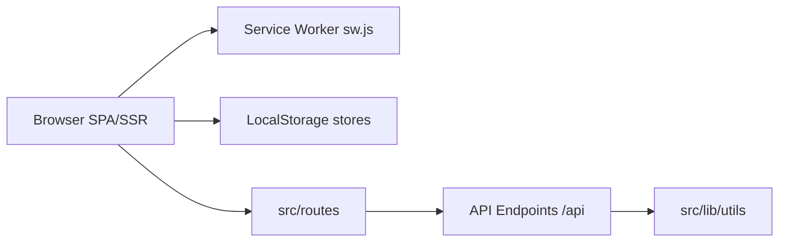

# Lissy93/networking-toolbox

> Offline SvelteKit networking toolbox for sysadmins: CIDR calculations, DNS, DHCP and diagnostics.

## The problem
Network calculations and conversions are scattered across third-party sites that require sending your data and having a connection.

## What it actually does
SvelteKit (TypeScript) application with hundreds of tools, using a service worker and localStorage for offline use, plus JSON API endpoints (`/api/...`). The business logic (CIDR, DHCP, DNS) lives in `src/lib/utils`. Deployable as static, Node, Docker or serverless through SvelteKit adapters.

## How it is wired


## Trying it
```bash
docker run -p 3000:3000 lissy93/networking-toolbox
```
```bash
git clone git@github.com:Lissy93/networking-toolbox.git
cd networking-toolbox
yarn
yarn dev
```

## Cost and gotchas
Free. The adapter choice is made through the `DEPLOY_ENV` variable at build time.

## What it is not
Not a monitoring or scanning tool: it is a set of web calculators and utilities. The README does not detail the list of tools.

## Alternatives
No alternative named in the README.

## For you
Worth watching: handy to self-host for a network admin, little related to a data/AI profile; MIT, recent activity.
