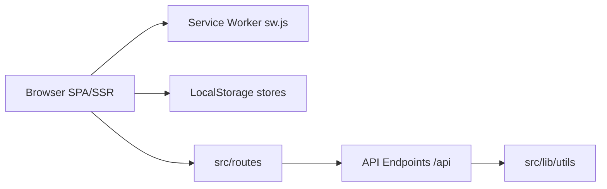

# Lissy93/networking-toolbox

> Boîte à outils réseau hors ligne en SvelteKit pour sysadmins : calculs CIDR, DNS, DHCP et diagnostics.

## Le problème
Les calculs et conversions réseau sont dispersés sur des sites tiers qui exigent d'envoyer ses données et une connexion.

## Ce que ça fait vraiment
Application SvelteKit (TypeScript) de centaines d'outils, avec service worker et localStorage pour l'usage hors ligne, plus des points d'API JSON (`/api/...`). La logique métier (CIDR, DHCP, DNS) vit dans `src/lib/utils`. Déployable en statique, Node, Docker ou serverless via des adaptateurs SvelteKit.

## Comment c'est branché


## Essayer
```bash
docker run -p 3000:3000 lissy93/networking-toolbox
```
```bash
git clone git@github.com:Lissy93/networking-toolbox.git
cd networking-toolbox
yarn
yarn dev
```

## Coût et pièges
Gratuit. Le choix d'adaptateur passe par la variable `DEPLOY_ENV` au build.

## Ce que ce n'est pas
Pas un outil de supervision ni de scan : c'est un ensemble de calculateurs et utilitaires web. Le README ne détaille pas la liste des outils.

## Alternatives
Aucune alternative nommée dans le README.

## Pour toi
À surveiller : pratique en auto-hébergement pour un admin réseau, peu lié à un profil data/IA ; MIT, activité récente.

