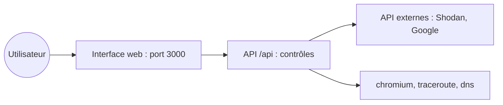

# Lissy93/web-check

> Website analysis dashboard (DNS, TLS, headers, technologies), for those who want to understand and secure their site.

## The problem
Knowing how a site is configured requires chaining many tools (DNS, certificates, headers, ports).

## What it actually does
Queries a site on demand and displays the result of several checks: IP address, SSL, DNS, headers, subdomains, rank, safe browsing, and others. Some checks require optional API keys (Google, Shodan, Cloudmersive, Tranco). Variables let you disable checks or block hosts.

## How it is wired

Simplified diagram based on the sheet, no diagram provided.

## Trying it
```bash
docker run -p 3000:3000 lissy93/web-check
git clone https://github.com/Lissy93/web-check.git
cd web-check
yarn install
yarn build
yarn start
```

## Cost and gotchas
Free, no configuration required by default. API keys are optional but unlock some checks. Node v22.23.4+ or v24.16+, plus chromium and traceroute for some checks. Restrict access with `API_BLOCKED_HOSTS` if you expose it.

## What it is not
Not an intrusion tool: it gathers public information about a site, it exploits nothing. Not a complete vulnerability scanner.

## Alternatives
No alternative named in the README.

## For you
Worth watching: handy for quickly auditing a site you host (model, API), no value for your data pipelines.
