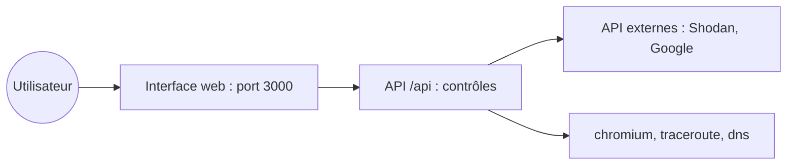

# Lissy93/web-check

> Tableau de bord d'analyse d'un site web (DNS, TLS, en-têtes, technologies), pour qui veut comprendre et sécuriser son site.

## Le problème
Savoir comment un site est configuré demande d'enchaîner de nombreux outils (DNS, certificats, en-têtes, ports).

## Ce que ça fait vraiment
Interroge un site à la demande et affiche le résultat de plusieurs contrôles : adresse IP, SSL, DNS, en-têtes, sous-domaines, rang, navigation sécurisée, et d'autres. Certains contrôles exigent des clés d'API optionnelles (Google, Shodan, Cloudmersive, Tranco). Variables pour désactiver des contrôles ou bloquer des hôtes.

## Comment c'est branché

Schéma simplifié d'après la fiche, sans diagramme fourni.

## Essayer
```bash
docker run -p 3000:3000 lissy93/web-check
git clone https://github.com/Lissy93/web-check.git
cd web-check
yarn install
yarn build
yarn start
```

## Coût et pièges
Gratuit, aucune configuration requise par défaut. Les clés d'API sont optionnelles mais débloquent certains contrôles. Node v22.23.4+ ou v24.16+, plus chromium et traceroute pour certains contrôles. Limiter l'accès avec `API_BLOCKED_HOSTS` si tu l'exposes.

## Ce que ce n'est pas
Pas un outil d'intrusion : il rassemble des informations publiques sur un site, il n'exploite rien. Pas un scanner de vulnérabilités complet.

## Alternatives
Aucune alternative nommée dans le README.

## Pour toi
À surveiller : pratique pour auditer vite un site que tu héberges (modèle, API), sans valeur pour tes pipelines data.

