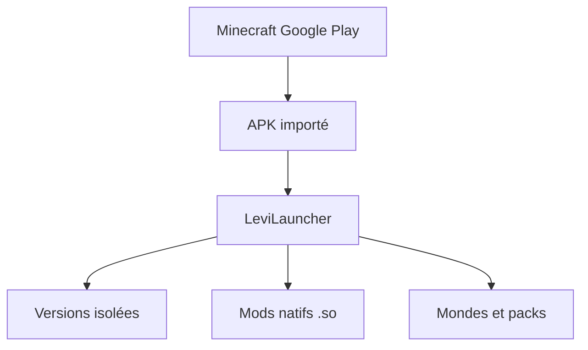

# LiteLDev/LeviLauncher-Android

> Android launcher for Minecraft Bedrock that manages several versions and loads native mods.

## The problem
On Android, switching between Minecraft Bedrock versions or loading native mods forces you to uninstall and reinstall the game.

## What it actually does
Imports official Minecraft APKs and runs them inside the launcher, with isolation between versions. Loads native mods (`.so` libraries), manages several Xbox accounts, imports, exports and backs up resource packs and worlds. Minecraft must have been purchased on Google Play (1.21.80 or newer).

## How it is wired
Simplified diagram based on the sheet, no diagram provided.



## Trying it
```bash
git clone https://github.com/LiteLDev/LeviLauncher-Android.git
./gradlew assembleDebug
```

## Cost and gotchas
Free, but Minecraft must be purchased; Android 9+, ARM64, 3 GB of RAM recommended. The README warns that any bans are at your own risk. Building requires JDK 21 and Android Studio.

## What it is not
Not a tool to bypass the game's license: a legitimate copy is required. No iOS version and none is planned.

## Alternatives
LiteLDev/LeviLauncher: the Windows version of the same project.

## For you
Ignore: gaming tool with no link to data, AI or MLOps.
