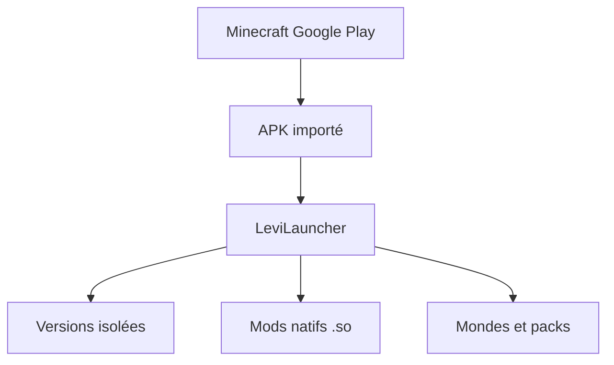

# LiteLDev/LeviLauncher-Android

> Lanceur Android pour Minecraft Bedrock qui gère plusieurs versions et charge des mods natifs.

## Le problème
Sur Android, passer d'une version de Minecraft Bedrock à l'autre ou charger des mods natifs oblige à désinstaller et réinstaller le jeu.

## Ce que ça fait vraiment
Importe des APK officiels de Minecraft et les exécute dans le lanceur, avec isolation entre versions. Charge des mods natifs (bibliothèques `.so`), gère plusieurs comptes Xbox, importe, exporte et sauvegarde packs de ressources et mondes. Il faut avoir Minecraft acheté sur Google Play (1.21.80 ou plus récent).

## Comment c'est branché
Schéma simplifié d'après la fiche, sans diagramme fourni.



## Essayer
```bash
git clone https://github.com/LiteLDev/LeviLauncher-Android.git
./gradlew assembleDebug
```

## Coût et pièges
Gratuit, mais Minecraft doit être acheté ; Android 9+, ARM64, 3 Go de RAM conseillés. Le README prévient que les bannissements éventuels sont à vos risques. La compilation demande JDK 21 et Android Studio.

## Ce que ce n'est pas
Pas un outil pour contourner la licence du jeu : une copie légitime est exigée. Pas de version iOS et aucune n'est prévue.

## Alternatives
LiteLDev/LeviLauncher : la version Windows du même projet.

## Pour toi
À ignorer : outil de jeu sans lien avec la data, l'IA ou le MLOps.

