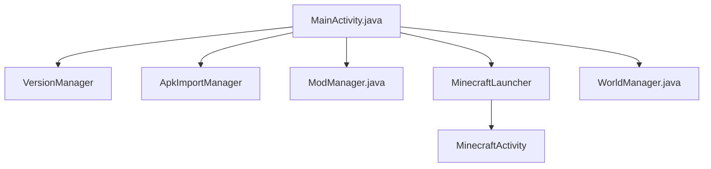

# LiteLDev/LeviLaunchroid

> Android launcher for Minecraft Bedrock that manages several versions and loads native mods.

## The problem
On Android, only one version of Minecraft Bedrock coexists with its data, and native mods do not load without a dedicated tool.

## What it actually does
Imports official APKs and runs them inside the launcher, with isolation between versions. Loads native mods (`.so`), manages several Xbox accounts, worlds and resource packs. The Google Play Minecraft must remain installed (1.21.80 or later).

## How it is wired
Simplified diagram based on the code's diagram.



## Trying it
```bash
git clone https://github.com/LiteLDev/LeviLaunchroid.git
./gradlew assembleDebug
```
Otherwise, download the APK from the releases page and install it.

## Cost and gotchas
A Minecraft Bedrock license purchased on Google Play is required. Android 9 minimum, ARM64 only. Building from source: JDK 21, Android Studio, NDK. Ban risk flagged by the authors.

## What it is not
Not a tool for playing a pirated copy. No iOS version, none is planned. No connection to data or AI.

## Alternatives
- LiteLDev/LeviLauncher: the Windows version of the same launcher.

## For you
Ignore: a game launcher unrelated to a data / AI / MLOps profile.
