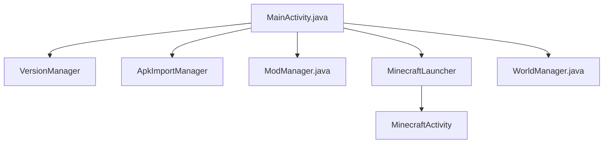

# LiteLDev/LeviLaunchroid

> Lanceur Android pour Minecraft Bedrock, qui gère plusieurs versions et charge des mods natifs.

## Le problème
Sur Android, une seule version de Minecraft Bedrock cohabite avec ses données, et les mods natifs ne se chargent pas sans outil dédié.

## Ce que ça fait vraiment
Importe des APK officiels et les exécute dans le lanceur, avec une isolation entre versions. Charge des mods natifs (`.so`), gère plusieurs comptes Xbox, les mondes et les packs de ressources. Le Minecraft de Google Play doit rester installé (1.21.80 ou plus).

## Comment c'est branché
Schéma simplifié d'après le diagramme du code.



## Essayer
```bash
git clone https://github.com/LiteLDev/LeviLaunchroid.git
./gradlew assembleDebug
```
Sinon, télécharger l'APK dans la page des releases et l'installer.

## Coût et pièges
Licence Minecraft Bedrock achetée sur Google Play obligatoire. Android 9 minimum, ARM64 uniquement. Build depuis les sources : JDK 21, Android Studio, NDK. Risque de bannissement signalé par les auteurs.

## Ce que ce n'est pas
Pas un outil pour jouer à une copie piratée. Pas de version iOS, aucune n'est prévue. Aucun lien avec la data ou l'IA.

## Alternatives
- LiteLDev/LeviLauncher : la version Windows du même lanceur.

## Pour toi
Ignorer : un lanceur de jeu sans rapport avec un profil data / IA / MLOps.

