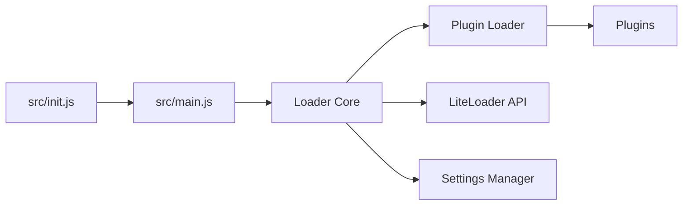

# LiteLoaderQQNT/LiteLoaderQQNT

> Plugin loader for the QQNT messaging client, archived, README in Chinese.

## The problem
QQNT offers no extension system to change its appearance or add features.

## What it actually does
Hooks into QQNT's startup (modifying `package.json` to point to a launcher) and loads plugins from a `plugins` folder, with a settings page, an API exposed to plugins and a protocol schema. Installation requires a non-public `dbghelp.dll` or a patch of the QQNT.dll file to bypass the verification.

## How it is wired


## Trying it
```bash
git clone --depth 1 https://github.com/LiteLoaderQQNT/LiteLoaderQQNT.git
```
Then a manual modification of QQNT's `package.json`, not scripted.

## Cost and gotchas
The repository is archived. The README warns that QQ may consider it an "illegal tool", disconnect the device or ban the account.

## What it is not
Not an official or maintained extension. Requires bypassing the client's integrity check.

## Alternatives
No alternative named in the README.

## For you
Ignore: archived project that bypasses the verification of a Chinese messaging client, with ban risk and no data/AI/MLOps use.
