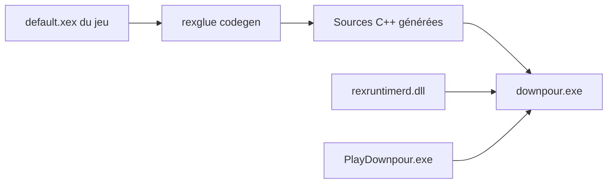

# LittleBitUA/DownpourRecomp

> Native Windows port of Silent Hill: Downpour (Xbox 360), obtained by static recompilation, for gamers.

## The problem
Silent Hill: Downpour never came out on PC, and Xbox 360 emulators run it at 30 frames per second without native keyboard and mouse.

## What it actually does
The game's PowerPC code is translated into x86-64 C++ at build time, then linked to a host runtime derived from the ReXGlue SDK. The result is a native downpour.exe at 60 frames per second, with keyboard and mouse, an installation wizard that reads your ISO, local achievements (F7 key) and a settings launcher.

## How it is wired


## Trying it
```bash
rexglue codegen --manifest downpour_manifest.toml

cmake -G Ninja -B out/build/win-amd64 -DCMAKE_BUILD_TYPE=RelWithDebInfo \
      -DCMAKE_C_COMPILER=clang -DCMAKE_CXX_COMPILER=clang++ \
      -DREXSDK_DIR=<path-to-rexglue-sdk-dpour>
ninja -C out/build/win-amd64 downpour
```

## Cost and gotchas
You must legally own the Xbox 360 game (ISO or XEX), a Direct3D 12 compatible GPU and Windows 10 or 11. The recompiled code generated at build time is not covered by the BSD-3-Clause license.

## What it is not
Not an emulator, and no game file is provided. No HDR or fixed ultrawide. The README mentions AI assistance (Claude Code) alongside manual work.

## Alternatives
Xenia: Xbox 360 emulator cited as a comparison, limited to 30 frames per second for this game according to the README.

## For you
Ignore: a game port unrelated to data, AI or MLOps, useful only if you want to replay this game.
