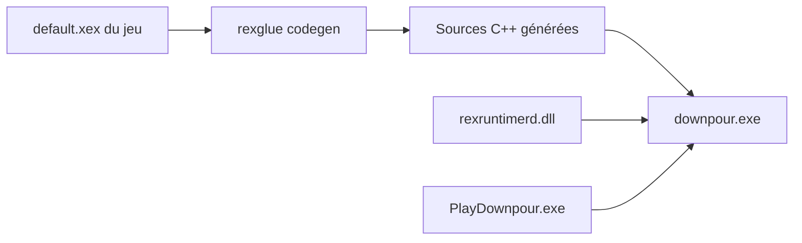

# LittleBitUA/DownpourRecomp

> Port Windows natif de Silent Hill: Downpour (Xbox 360), obtenu par recompilation statique, pour joueurs.

## Le problème
Silent Hill: Downpour n'est jamais sorti sur PC, et les émulateurs Xbox 360 le font tourner à 30 images par seconde sans clavier-souris natif.

## Ce que ça fait vraiment
Le code PowerPC du jeu est traduit en C++ x86-64 à la compilation, puis lié à un runtime hôte dérivé du SDK ReXGlue. Le résultat est un downpour.exe natif à 60 images par seconde, avec clavier-souris, un assistant d'installation qui lit ton ISO, des succès locaux (touche F7) et un lanceur de réglages.

## Comment c'est branché


## Essayer
```bash
rexglue codegen --manifest downpour_manifest.toml

cmake -G Ninja -B out/build/win-amd64 -DCMAKE_BUILD_TYPE=RelWithDebInfo \
      -DCMAKE_C_COMPILER=clang -DCMAKE_CXX_COMPILER=clang++ \
      -DREXSDK_DIR=<path-to-rexglue-sdk-dpour>
ninja -C out/build/win-amd64 downpour
```

## Coût et pièges
Il faut posséder légalement le jeu Xbox 360 (ISO ou XEX), un GPU compatible Direct3D 12 et Windows 10 ou 11. Le code recompilé généré à la compilation n'est pas couvert par la licence BSD-3-Clause.

## Ce que ce n'est pas
Pas un émulateur, et aucun fichier du jeu n'est fourni. Pas de HDR ni d'ultrawide corrigé. Le README mentionne un usage d'assistance IA (Claude Code) aux côtés du travail manuel.

## Alternatives
Xenia : émulateur Xbox 360 cité en comparaison, limité à 30 images par seconde pour ce jeu selon le README.

## Pour toi
À ignorer : un port de jeu sans rapport avec la data, l'IA ou le MLOps, utile seulement si tu veux rejouer à ce jeu.

