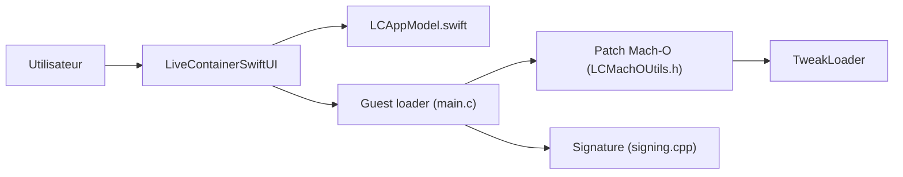

# LiveContainer/LiveContainer

> iOS app launcher that runs apps inside a host app, for iPhone users sideloading IPAs.

## The problem
A free developer account limits the number of apps (3 apps, 10 identifiers) installable by sideloading.

## What it actually does
A single app and a single identifier serve as the host: you install as many IPAs as you like in it, with several versions and data containers. It modifies the guest executable (`__PAGEZERO` segment, `MH_EXECUTE` turned into `MH_DYLIB`), redirects `@executable_path` and `NSBundle.mainBundle`, loads the executable via `dlopen` and jumps to the entry point. With JIT (before iOS 26) signing is bypassed, otherwise the app is signed with LiveContainer's certificate. Multitasking in virtual windows, Picture-in-Picture, tweaks, SideStore integration.

## How it is wired

## Trying it
No documented command for usage; to build: open Xcode and set `DEVELOPMENT_TEAM[config=Debug]` in `xcconfigs/Global.xcconfig`, then build. Installation: app to be installed via AltStore 2.0+ or SideStore 0.6.0+, then add IPAs with the plus button.

## Cost and gotchas
Free, AGPL-3.0. Requires iOS/iPadOS 15+ and a sideloading tool. Documented limitations: permissions applied globally, containers not isolated from each other, no remote push notifications, no app extensions. Closed third-party builds are circulating and would have access to your data, keychain included, according to the README warning.

## What it is not
Not an emulator or a hypervisor. Not all apps work: a compatibility list exists.

## Alternatives
SideStore and AltStore are cited as installation tools it is used with, not as replacements.

## For you
Ignore: iOS sideloading tool with no link to data/AI work; the risks of third-party builds and weakened isolation are one more reason not to bother.
