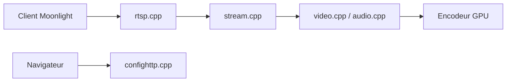

# LizardByte/Sunshine

> Self-hosted, low-latency game streaming host for Moonlight clients.

## The problem
Playing on or controlling a powerful machine remotely without a third-party cloud gaming service.

## What it actually does
The Moonlight client connects through the network layer and RTSP. The stream orchestrator captures the screen and audio, accepts input (emulated gamepads), encodes the video (NVENC, AMF, QuickSync, VAAPI, Vulkan Video, VideoToolbox or software) and sends the stream back. An HTTPS web interface handles configuration and pairing.

## How it is wired

## Trying it
The README gives no command; it points to the documentation on Read the Docs. Compatibility matrices are provided (OS, encoding API, capture).

## Cost and gotchas
Free. A compatible GPU is required. On macOS and Windows, some gamepad profiles require a separately licensed Virtual HID Broker. The README warns that the hardware tables are provisional.

## What it is not
Not a hosted cloud service. Not a data visualization tool.

## Alternatives
No alternative named in the README.

## For you
Ignore: unrelated to data or AI; useful only for a gaming or remote desktop need.
