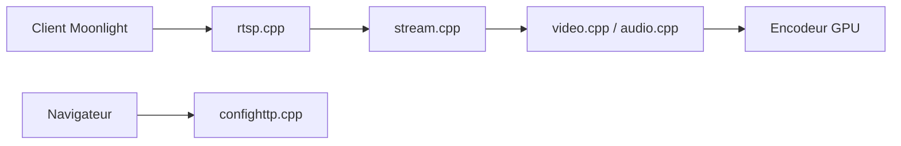

# LizardByte/Sunshine

> Hôte de streaming de jeux auto-hébergé pour clients Moonlight, à faible latence.

## Le problème
Jouer ou piloter un poste puissant à distance sans service de cloud gaming tiers.

## Ce que ça fait vraiment
Le client Moonlight se connecte via la couche réseau et RTSP. L'orchestrateur de flux capture l'écran et l'audio, accepte les entrées (manettes émulées), encode la vidéo (NVENC, AMF, QuickSync, VAAPI, Vulkan Video, VideoToolbox ou logiciel) et renvoie le flux. Une interface web HTTPS sert à la configuration et à l'appairage.

## Comment c'est branché

## Essayer
Le README ne donne pas de commande ; il renvoie à la documentation sur Read the Docs. Matrices de compatibilité fournies (OS, API d'encodage, capture).

## Coût et pièges
Gratuit. GPU compatible nécessaire. Sur macOS et Windows, certains profils de manette exigent un Virtual HID Broker séparé sous licence. Le README avertit que les tableaux de matériel sont provisoires.

## Ce que ce n'est pas
Pas un service cloud hébergé. Pas un outil de visualisation de données.

## Alternatives
Aucune alternative nommée dans le README.

## Pour toi
Ignorer : sans rapport avec la data ou l'IA ; utile seulement pour un besoin de jeu ou de poste distant.

