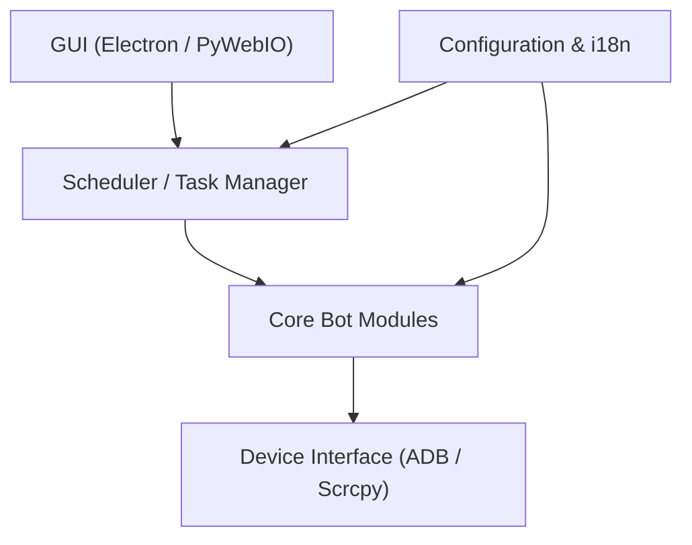

# LmeSzinc/AzurLaneAutoScript

> Automation bot for the mobile game Azur Lane, for players who want to delegate repetitive tasks.

## The problem
The game imposes repetitive daily tasks (sorties, commissions, research, shops) that take time.

## What it actually does
Drives an emulator or a device via ADB/scrcpy. A scheduler launches independent tasks and sets their next run (for example after a 4-hour research). Handles character mood, the world map, and a map recognition finer than plain template matching. Web interface (PyWebIO / Electron).

## How it is wired

## Trying it
The README gives no command: it points to an external installation tutorial. No command reproduced.

## Cost and gotchas
Free, GPL-3.0 license (copyleft). Requires aligning many in-game settings and does not absorb network outages. Automating a game may violate its terms of use.

## What it is not
Not a general automation or application testing tool: it is specific to Azur Lane.

## Alternatives
StarRailCopilot (Honkai Star Rail), MaaAssistantArknights (Arknights) and FGO-py (Fate/Grand Order), cited as related projects.

## For you
Ignore: game tool unrelated to your work; only the map recognition might be of interest for vision, but nothing justifies it.
