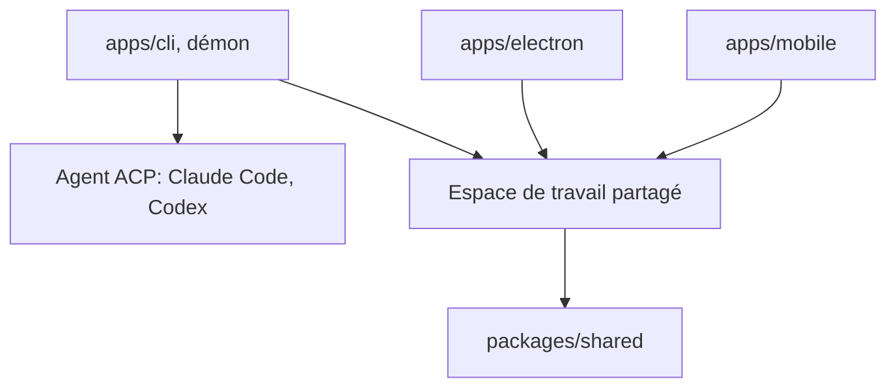

# LodyAI/Lody

> Shared workspace where a team drives its coding agents (Claude Code, Codex, Kimi) from several machines.

## The problem
Conversations with coding agents stay on each person's machine; sharing them means exchanging screenshots and logs.

## What it actually does
A daemon connects a machine to the workspace via the ACP protocol. The team sees a session's transcript, state, files and diffs, and launches work from desktop, mobile, web or the CLI. Sessions can have their own Git worktree, be forked and call one another. Collaborative state relies on Loro (CRDT).

## How it is wired
Simplified diagram based on the card, no diagram provided.


## Trying it
```bash
npx lody daemon start
npx lody session create --workspace my-team --agent-config codex --repo owner/repo "Fix the failing test"
npx lody session list --workspace my-team
```

## Cost and gotchas
Agent subscriptions and models remain yours. The README gives no price for the workspace or for the optional cloud. Full local-first support is not yet reached; 325 open issues.

## What it is not
It is not a coding agent: it orchestrates them. Documents and sandboxes are announced, not delivered. The mobile clients are under active development.

## Alternatives
No alternative named in the README.

## For you
Worth watching: coordinating several coding agents across several people can help an AI team, but the repo is young (August 2026) and its pricing is not documented.
