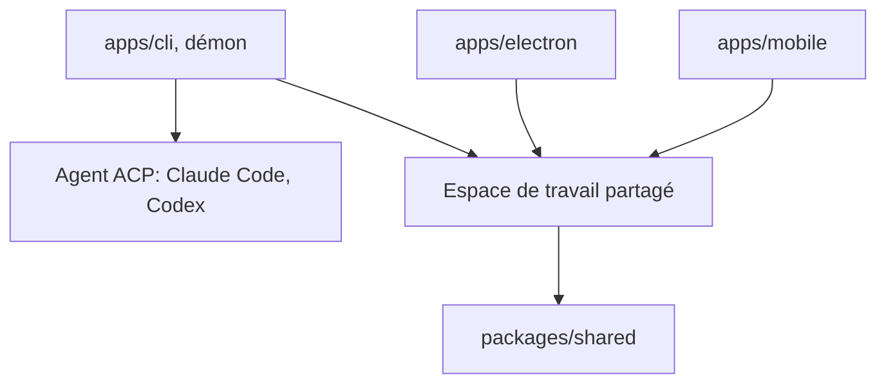

# LodyAI/Lody

> Espace de travail partagé où une équipe pilote ses agents de code (Claude Code, Codex, Kimi) depuis plusieurs machines.

## Le problème
Les conversations avec les agents de code restent sur la machine de chacun ; les partager revient à échanger des captures et des logs.

## Ce que ça fait vraiment
Un démon relie une machine à l'espace de travail via le protocole ACP. L'équipe voit la transcription, l'état, les fichiers et les diffs d'une session, et lance du travail depuis le bureau, le mobile, le web ou la CLI. Les sessions peuvent avoir leur worktree Git, être forkées et s'appeler entre elles. L'état collaboratif repose sur Loro (CRDT).

## Comment c'est branché
Schéma simplifié d'après la fiche, sans diagramme fourni.


## Essayer
```bash
npx lody daemon start
npx lody session create --workspace my-team --agent-config codex --repo owner/repo "Fix the failing test"
npx lody session list --workspace my-team
```

## Coût et pièges
Les abonnements et modèles des agents restent les tiens. Le README ne donne aucun prix pour l'espace de travail ni pour le cloud optionnel. Le support local-first complet n'est pas encore atteint ; 325 issues ouvertes.

## Ce que ce n'est pas
Ce n'est pas un agent de code : il en orchestre. Documents et bacs à sable sont annoncés, pas livrés. Les clients mobiles sont en développement actif.

## Alternatives
Aucune alternative nommée dans le README.

## Pour toi
À surveiller : coordonner plusieurs agents de code à plusieurs peut aider une équipe IA, mais le dépôt est jeune (août 2026) et sa tarification n'est pas documentée.

