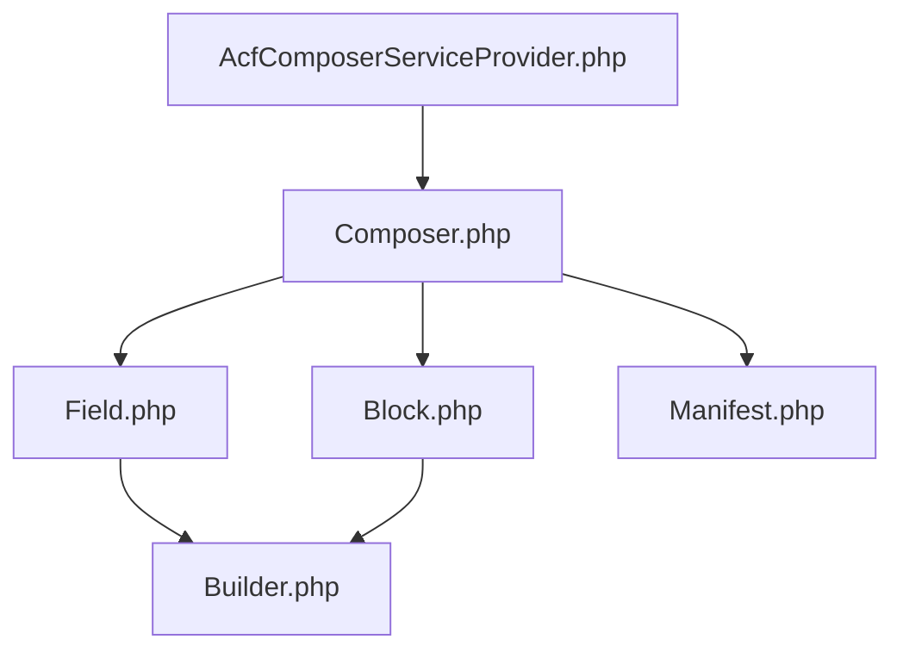

# Log1x/acf-composer

> Generator of ACF fields, blocks, widgets and options pages for Sage WordPress themes.

## The problem
Declaring ACF fields and their blocks by hand in a Sage theme mixes code and configuration, and slows loading.

## What it actually does
`wp acorn acf:...` commands generate PHP classes (Field, Block, Widget, Options) built with ACF Builder, plus their Blade views. A cache command writes the blocks to `block.json` and the fields to a manifest.

## How it is wired


## Trying it
```bash
composer require log1x/acf-composer
wp acorn vendor:publish --tag="acf-composer"
wp acorn acf:field ExampleField
```

## Cost and gotchas
Requires Sage 10+, Acorn 3+ and ACF Pro 5.8+, which is paid. PHP is required but is not in the prerequisites list. After caching, any change only takes effect once the cache is cleared.

## What it is not
Not a generic tool: it only works with WordPress, Sage and ACF. Widgets are described as almost obsolete.

## Alternatives
No alternative named in the README.

## For you
Ignore: a WordPress theme development tool, unrelated to data or AI.
