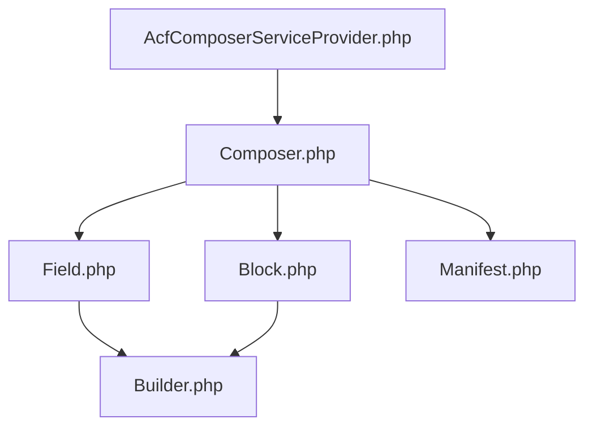

# Log1x/acf-composer

> Générateur de champs, blocs, widgets et pages d'options ACF pour les thèmes WordPress Sage.

## Le problème
Déclarer à la main des champs ACF et leurs blocs dans un thème Sage mélange code et configuration, et ralentit le chargement.

## Ce que ça fait vraiment
Des commandes `wp acorn acf:...` génèrent des classes PHP (Field, Block, Widget, Options) construites avec ACF Builder, plus leurs vues Blade. Une commande de cache écrit les blocs en `block.json` et les champs dans un manifeste.

## Comment c'est branché


## Essayer
```bash
composer require log1x/acf-composer
wp acorn vendor:publish --tag="acf-composer"
wp acorn acf:field ExampleField
```

## Coût et pièges
Demande Sage 10+, Acorn 3+ et ACF Pro 5.8+, qui est payant. PHP est requis mais n'est pas dans la liste de prérequis. Après mise en cache, toute modification ne compte qu'une fois le cache vidé.

## Ce que ce n'est pas
Pas un outil générique : il ne sert qu'avec WordPress, Sage et ACF. Les widgets sont décrits comme presque obsolètes.

## Alternatives
Aucune alternative nommée dans le README.

## Pour toi
À ignorer : outil de développement de thèmes WordPress, sans rapport avec la data ou l'IA.

