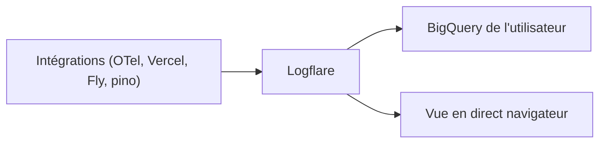

# Logflare/logflare

> Service that centralizes logs, shows them live and writes them to your own BigQuery.

## The problem
Centralizing logs without storage lock-in: you want to view them live while keeping your data.

## What it actually does
The README is short. It describes a stream of logs to a central service, viewable in the browser; with your BigQuery credentials, logs go into your table with automatic schema management. Listed integrations: OpenTelemetry, Vercel, Fly, GitHub Action, pino, winston, Elixir, Erlang. It is now part of Supabase.

## How it is wired

## Trying it
No command documented in the README (sign up on logflare.app).

## Cost and gotchas
An account on logflare.app is required; BigQuery is billed by Google. Pricing is not specified here.

## What it is not
Not a self-hosting guide: the README points to the hosted service. Architecture details are not documented.

## Alternatives
None named in the README.

## For you
Keep an eye on it if you already store logs in BigQuery; the material here is too thin to conclude further.
