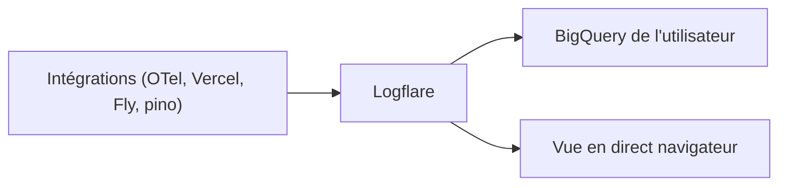

# Logflare/logflare

> Service qui centralise des logs, les affiche en direct et les écrit dans ton propre BigQuery.

## Le problème
Centraliser les logs sans verrouillage de stockage : on veut les consulter en direct tout en gardant ses données.

## Ce que ça fait vraiment
Le README est court. Il décrit un flux de logs vers un service central, consultable dans le navigateur ; avec tes identifiants BigQuery, les logs vont dans ta table avec gestion automatique du schéma. Intégrations listées : OpenTelemetry, Vercel, Fly, GitHub Action, pino, winston, Elixir, Erlang. Fait maintenant partie de Supabase.

## Comment c'est branché

## Essayer
Aucune commande documentée dans le README (inscription sur logflare.app).

## Coût et pièges
Compte requis sur logflare.app ; BigQuery facturé par Google. Tarification non précisée ici.

## Ce que ce n'est pas
Pas un guide d'auto-hébergement : le README pointe vers le service hébergé. Détails d'architecture non documentés.

## Alternatives
Aucune nommée dans le README.

## Pour toi
À surveiller si tu stockes déjà des logs dans BigQuery ; matière trop mince ici pour trancher davantage.

