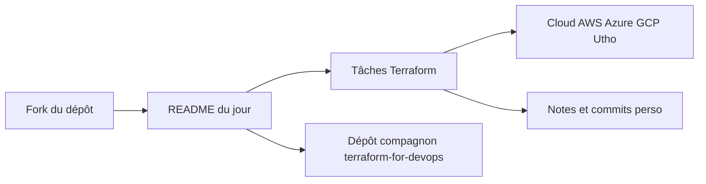

# LondheShubham153/TerraWeek

> Seven-day Terraform challenge with daily exercises, for learning infrastructure as code on a cloud.

## The problem
Learning Terraform alone lacks rhythm and guided exercises. Without a framework, you read the docs without ever building infrastructure.

## What it actually does
A program dated October 11 to 17, 2026: one folder per day (IaC basics, HCL, providers, state and backends, modules, final project, wrap-up). Each day has its README with tasks. The reference code is in a companion repository and a video. Nothing runs in this repository.

## How it is wired
Simplified diagram based on the fiche, no diagram provided.



## Trying it
```bash
terraform destroy
```
The README documents only this command (to run after each task); the rest goes through the daily READMEs.

## Cost and gotchas
You need a cloud account (AWS, Azure, GCP or Utho) with its CLI configured, and Terraform 1.15 or later. Stay within the free tier and destroy the resources, otherwise you get a bill.

## What it is not
It is neither a library nor a tool: it is course material. The event has fixed dates, now past. No license is declared.

## Alternatives
- terraform-for-devops: the companion repository with the real code and AWS examples.
- developer.hashicorp.com/terraform/tutorials: official HashiCorp tutorials, cited in the README.

## For you
Watch: useful if you are starting Terraform for MLOps, useless if you already practice it, and without a license you cannot reuse it as is.
