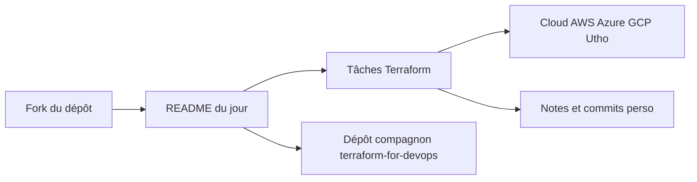

# LondheShubham153/TerraWeek

> Défi Terraform de sept jours avec exercices quotidiens, pour apprendre l'infrastructure as code sur un cloud.

## Le problème
Apprendre Terraform seul manque de rythme et d'exercices guidés. Sans cadre, on lit la doc sans jamais construire d'infrastructure.

## Ce que ça fait vraiment
Un programme daté du 11 au 17 octobre 2026 : un dossier par jour (bases IaC, HCL, providers, state et backends, modules, projet final, bilan). Chaque jour a son README avec des tâches. Le code de référence est dans un dépôt compagnon et une vidéo. Rien ne s'exécute dans ce dépôt.

## Comment c'est branché
Schéma simplifié d'après la fiche, sans diagramme fourni.



## Essayer
```bash
terraform destroy
```
Le README ne documente que cette commande (à lancer après chaque tâche) ; le reste passe par les README quotidiens.

## Coût et pièges
Il faut un compte cloud (AWS, Azure, GCP ou Utho) avec son CLI configuré, et Terraform 1.15 ou plus. Rester dans le free tier et détruire les ressources, sinon facture.

## Ce que ce n'est pas
Ce n'est ni une bibliothèque ni un outil : c'est un support de cours. L'événement a des dates fixes, passées. Aucune licence n'est déclarée.

## Alternatives
- terraform-for-devops : le dépôt compagnon avec le code réel et des exemples AWS.
- developer.hashicorp.com/terraform/tutorials : tutoriels officiels HashiCorp, cités dans le README.

## Pour toi
Surveiller : utile si tu débutes Terraform pour du MLOps, inutile si tu le pratiques déjà, et sans licence tu ne peux pas le réutiliser tel quel.

