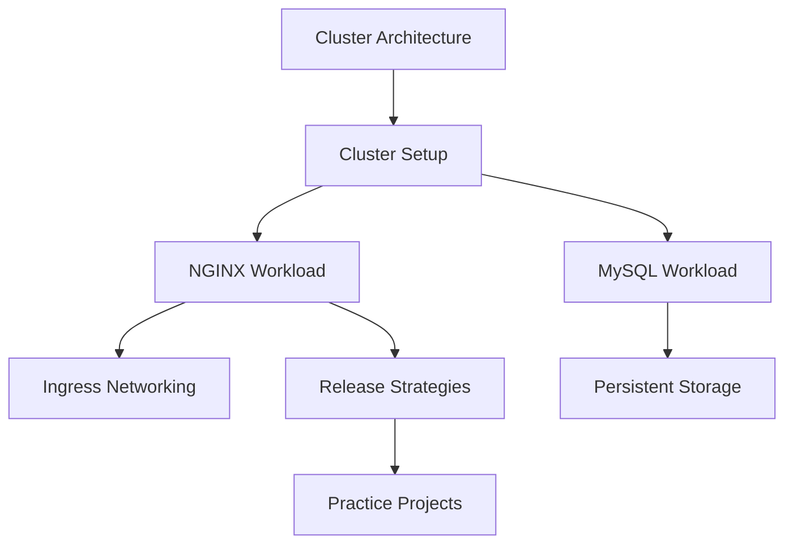

# LondheShubham153/kubestarter

> Kubernetes learning repository: guides, YAML examples and hands-on projects for beginners.

## The problem
Learning Kubernetes means connecting architecture, resources, installation and deployments, which are often scattered.

## What it actually does
Brings together an architecture guide, NGINX and MySQL examples (ConfigMaps, Secrets, volumes), and folders by topic: DaemonSet, Ingress, HPA and VPA, RBAC, Helm, deployment strategies. Adds installation guides (Kubeadm, Minikube, KIND, EKS) and hands-on projects.

## How it is wired

## Trying it
No command documented in the README: you follow the linked guides, such as `kubernetes_architecture.md` and then the `examples/nginx` and `examples/mysql` folders.

## Cost and gotchas
Free to read. The EKS guide requires an AWS account and may incur charges. No license declared.

## What it is not
It is not a tool or a Kubernetes distribution: only teaching material. No AI- or MLOps-specific example.

## Alternatives
No alternative named in the README.

## For you
Keep an eye on it: handy for reviewing Kubernetes basics before deploying models, but the missing license limits reuse.
