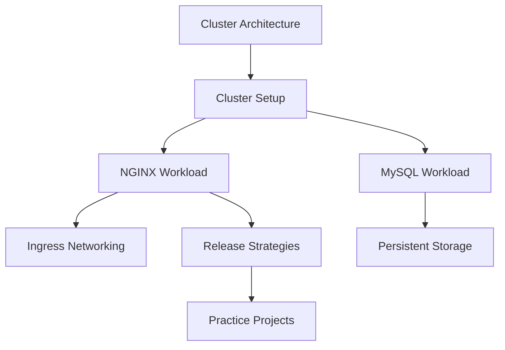

# LondheShubham153/kubestarter

> Dépôt d'apprentissage Kubernetes : guides, exemples YAML et projets pratiques pour débutants.

## Le problème
Apprendre Kubernetes demande de relier architecture, ressources, installation et déploiements, souvent dispersés.

## Ce que ça fait vraiment
Rassemble un guide d'architecture, des exemples NGINX et MySQL (ConfigMaps, Secrets, volumes), et des dossiers par thème : DaemonSet, Ingress, HPA et VPA, RBAC, Helm, stratégies de déploiement. Ajoute des guides d'installation (Kubeadm, Minikube, KIND, EKS) et des projets pratiques.

## Comment c'est branché

## Essayer
Aucune commande documentée dans le README : on suit les guides liés, comme `kubernetes_architecture.md` puis les dossiers `examples/nginx` et `examples/mysql`.

## Coût et pièges
Gratuit pour lire. Le guide EKS exige un compte AWS et peut générer une facture. Aucune licence déclarée.

## Ce que ce n'est pas
Ce n'est pas un outil ni une distribution Kubernetes : seulement du matériel pédagogique. Pas d'exemple spécifique à l'IA ou au MLOps.

## Alternatives
Aucune alternative nommée dans le README.

## Pour toi
À surveiller : pratique pour revoir les bases de Kubernetes avant de déployer des modèles, mais la licence absente limite la réutilisation.

