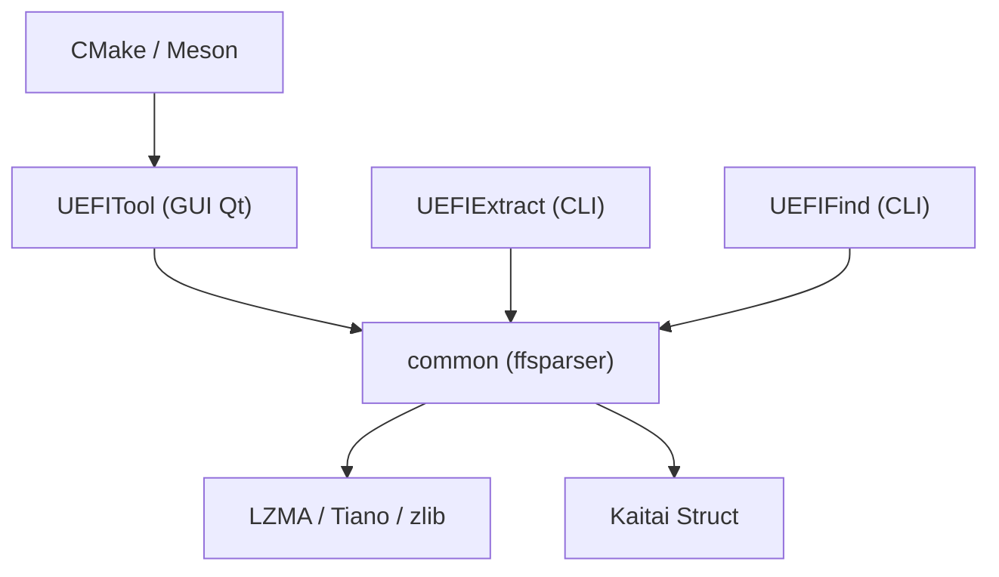

# LongSoft/UEFITool

> UEFI firmware image viewer in C++/Qt, for analysts and BIOS tinkerers.

## The problem
There was no free cross-platform tool to explore the inside of a UEFI firmware image.

## What it actually does
Parses a UEFI image into a tree, checks its integrity and offers an interface to browse it. UEFIExtract dumps the tree to disk; UEFIFind searches for a pattern. Editing is only possible in the old version 0.28 (old_engine branch); image reconstruction is still a work in progress.

## How it is wired


## Trying it
```bash
qmake ./UEFITool/uefitool.pro
cmake UEFIExtract
```

## Cost and gotchas
Free. Building requires a C++ compiler and Qt5 or Qt6 for the interface, CMake or Meson for the console tools. Some update files (encrypted HP, Dell) cannot be opened.

## What it is not
Not a full editor for now. Not an offensive security tool: it reads and extracts images.

## Alternatives
FMMT (TianoCore), Fiano (Google and Facebook), uefi-firmware-parser, Chipsec, PhoenixTool.

## For you
Ignore: firmware analysis, outside the data / AI / MLOps scope.
