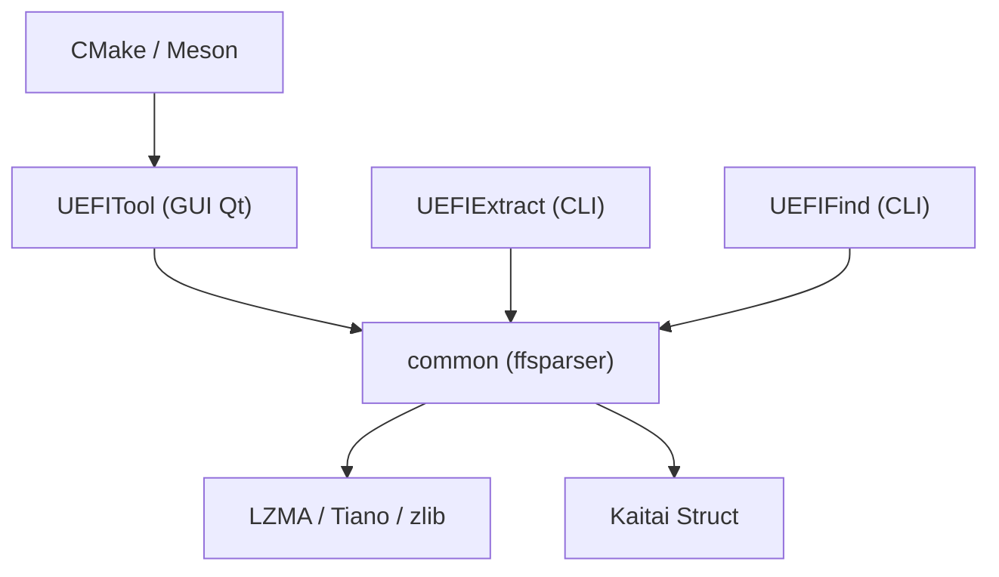

# LongSoft/UEFITool

> Visionneuse d'images firmware UEFI en C++/Qt, pour analystes et bricoleurs de BIOS.

## Le problème
Il manquait un outil libre multiplateforme pour explorer l'intérieur d'une image firmware UEFI.

## Ce que ça fait vraiment
Analyse une image UEFI en arbre, vérifie son intégrité et propose une interface pour la parcourir. UEFIExtract en déverse l'arbre sur disque ; UEFIFind cherche un motif. L'édition n'est possible que dans l'ancienne version 0.28 (branche old_engine) ; la reconstruction d'image est encore en chantier.

## Comment c'est branché


## Essayer
```bash
qmake ./UEFITool/uefitool.pro
cmake UEFIExtract
```

## Coût et pièges
Gratuit. Compilation avec compilateur C++ et Qt5 ou Qt6 pour l'interface, CMake ou Meson pour les outils en console. Certains fichiers de mise à jour (HP chiffrés, Dell) ne s'ouvrent pas.

## Ce que ce n'est pas
Pas un éditeur complet pour l'instant. Pas un outil de sécurité offensive : il lit et extrait des images.

## Alternatives
FMMT (TianoCore), Fiano (Google et Facebook), uefi-firmware-parser, Chipsec, PhoenixTool.

## Pour toi
Ignorer : analyse de firmware, hors périmètre data / IA / MLOps.

