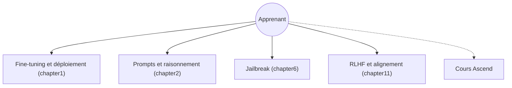

# Lordog/dive-into-llms

> A series of practical tutorials in Chinese on large language models, based on courses from the Jiao Tong University of Shanghai.

## The problem
Students and researchers lack practical pathways to develop expertise in fine-tuning, reasoning, security, and agent development.

## What it actually does
Eleven chapters, each with lessons, tutorials, and scripts: fine-tuning and deployment, prompts and chain-of-thought, knowledge editing, mathematical reasoning (mini R1), watermarking, jailbreaking, steganography, multimodal, GUI agents, agent security, RLHF. A separate course on Ascend (Huawei) is mentioned. The content of the notebooks has not been reviewed (not documented here).

## How it is wired

## Trying it
No documented commands: open the README file and follow the links in each chapter (`documents/chapterN/README.md`).

## Cost and gotchas
Free. Text in Chinese. The README does not mention the GPUs or API keys required for the scripts.

## What it is not
This is neither a library nor a framework. The README states that the "tips are provided 'as is' and without any warranty." There is no stated license, so the reuse of the content is unclear. The last commit was in October 2025.

## Alternatives
No alternative is specified in the README file.

## For you
Useful as a reading program on the security of LLMs (jailbreaking, watermarking, RLHF), especially if you are reading in Chinese; without a license, do not copy anything.
