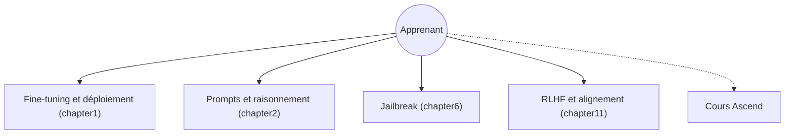

# Lordog/dive-into-llms

> Série de tutoriels pratiques en chinois sur les grands modèles, issue de cours de l'université Jiao Tong de Shanghai.

## Le problème
Les étudiants et chercheurs manquent de parcours pratiques pour toucher au fine-tuning, au raisonnement, à la sécurité et aux agents.

## Ce que ça fait vraiment
Onze chapitres, chacun avec cours, tutoriel et script : fine-tuning et déploiement, prompts et chaîne de pensée, édition de connaissances, raisonnement mathématique (mini R1), filigrane, jailbreak, stéganographie, multimodal, agents GUI, sécurité des agents, RLHF. Un cours séparé sur Ascend (Huawei) est cité. Le contenu des notebooks n'a pas été examiné (non documenté ici).

## Comment c'est branché

## Essayer
Aucune commande documentée : ouvrir le README et suivre les liens de chaque chapitre (`documents/chapterN/README.md`).

## Coût et pièges
Gratuit. Texte en chinois. Le README ne dit rien des GPU ni des clés d'API nécessaires aux scripts.

## Ce que ce n'est pas
Pas une bibliothèque ni un framework. Le README précise que les astuces sont « sans garantie ». Aucune licence déclarée, donc la réutilisation du contenu est floue. Le dernier push date d'octobre 2025.

## Alternatives
Aucune alternative nommée dans le README.

## Pour toi
Utile comme programme de lecture sur la sécurité des LLM (jailbreak, filigrane, RLHF) si tu lis le chinois ; sans licence, ne copie rien.

