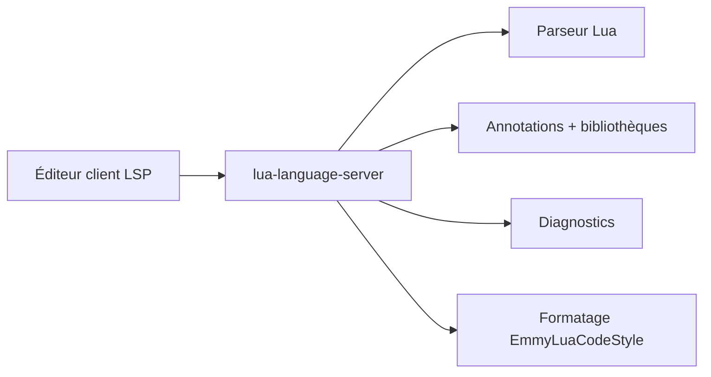

# LuaLS/lua-language-server

> LSP server for Lua: completion, diagnostics, types, for VS Code, Neovim and other editors.

## The problem
Dynamic Lua without static analysis hides type errors and makes navigation difficult.

## What it actually does
Provides go to definition, references, rename, hover, completion, formatting, syntax and dynamic type checking, plus more than twenty documentation annotations, plugins and documentation generation. Supports Lua 5.1 to 5.5 and LuaJIT. Telemetry, formerly optional, was removed in v3.6.5.

## How it is wired

## Trying it
No command documented: installation instructions are deferred to the project's website.

## Cost and gotchas
Free. 715 open issues. Depends on the client's configuration to define the Lua version and the libraries.

## What it is not
Not a universal formatter nor a Lua runner. Translations are community-made.

## Alternatives
No alternative named in the README.

## For you
Adopt if you write Lua (Neovim config): the reference LSP for the language, MIT, no telemetry.
