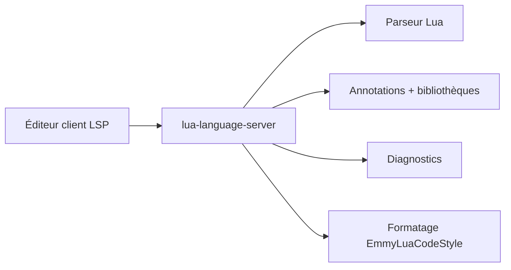

# LuaLS/lua-language-server

> Serveur LSP pour Lua : complétion, diagnostics, types, pour VS Code, Neovim et autres éditeurs.

## Le problème
Lua dynamique sans analyse statique cache erreurs de type et rend la navigation difficile.

## Ce que ça fait vraiment
Fournit aller à la définition, références, renommage, survol, complétion, formatage, vérification de syntaxe et de types dynamiques, plus de vingt annotations de documentation, plugins et génération de documentation. Supporte Lua 5.1 à 5.5 et LuaJIT. La télémétrie, autrefois en option, a été retirée en v3.6.5.

## Comment c'est branché

## Essayer
Aucune commande documentée : les instructions d'installation sont renvoyées au site web du projet.

## Coût et pièges
Gratuit. 715 issues ouvertes. Dépendance à la config du client pour définir la version de Lua et les bibliothèques.

## Ce que ce n'est pas
Pas un formateur universel ni un exécuteur Lua. Les traductions sont communautaires.

## Alternatives
Aucune alternative nommée dans le README.

## Pour toi
À adopter si tu écris du Lua (config Neovim) : la référence LSP du langage, MIT, sans télémétrie.

