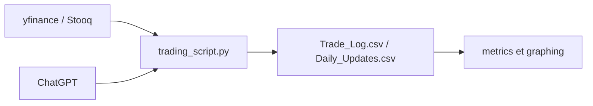

# LuckyOne7777/ChatGPT-Micro-Cap-Experiment

> Six-month experiment where ChatGPT manages a real micro-cap portfolio, with logs and evaluation.

## The problem
Promises of AI that "picks stocks" are almost never tested transparently.

## What it actually does
Publishes trade logs, daily updates as CSV, weekly research and a 40-page evaluation. The `trading_script.py` script applies an automatic stop-loss, compares against the S&P 500 and the Russell 2000, computes Sharpe, Sortino, CAPM and drawdown. Data via yfinance, Stooq fallback. The reusable framework is referred to LIBB.

## How it is wired


## Trying it
```bash
# Aucune commande documentée dans le README (dépendances dans requirements.txt)
```

## Cost and gotchas
Decisions come from ChatGPT, at your expense. No license declared: reuse is legally uncertain. Real money was at stake in the original experiment.

## What it is not
Not financial advice nor a proven strategy: it is an experiment.

## Alternatives
LIBB (LLM Investor Behavior Benchmark), the author's framework cited in the README.

## For you
Keep an eye on it: good case study for evaluating LLMs in decision-making, to read rather than run, with no clear license.
