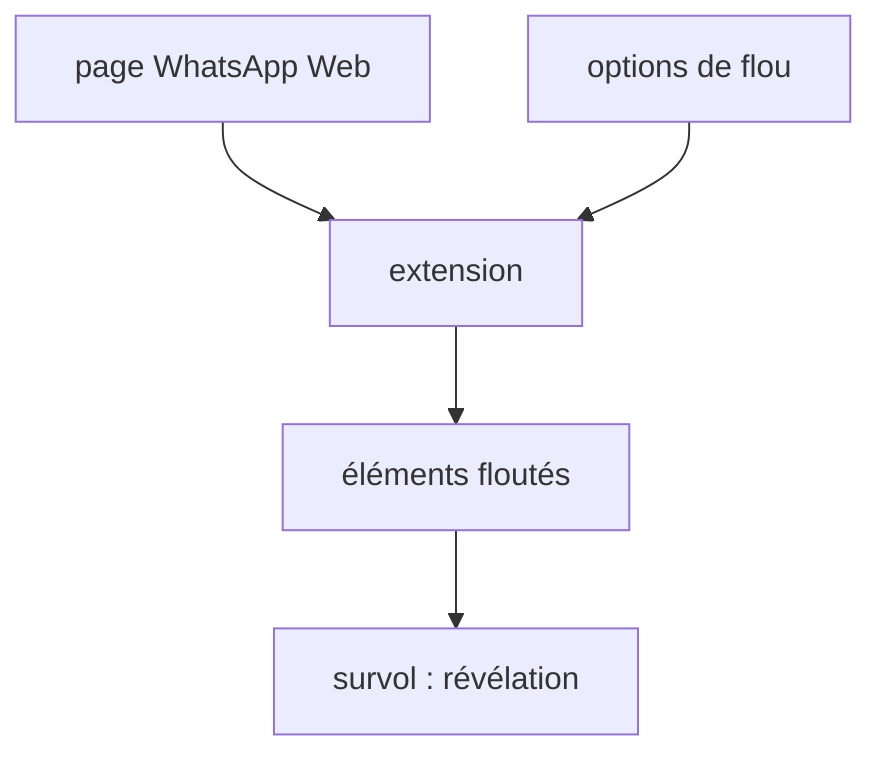

# LukasLen/Privacy-Extension-For-WhatsApp-Web

> Browser extension that blurs WhatsApp Web messages until the mouse hovers over them.

## The problem
Reading your messages in a public place exposes their content to prying eyes.

## What it actually does
Blurs messages, previews, media, profile pictures and names, as you choose. They are revealed on hover; Alt+X shortcut toggles everything. Available on Chrome and Firefox; the README states it collects nothing from your messages, except problem or update information through its server.

## How it is wired
Simplified diagram based on the sheet, no diagram provided.

## Trying it
Install through the Chrome and Firefox stores; for development: developer mode, "Load Unpacked" on the /src folder.

## Cost and gotchas
The README announces that the project is no longer maintained (archived repository) in favor of another repository. The extension contacts a server for notices.

## What it is not
Not encryption nor data protection: a simple visual effect.

## Alternatives
privacy-whatsapp-web-auto-blur: continuation of the development, cited in the README.

## For you
Ignore: archived and unrelated to your work.
