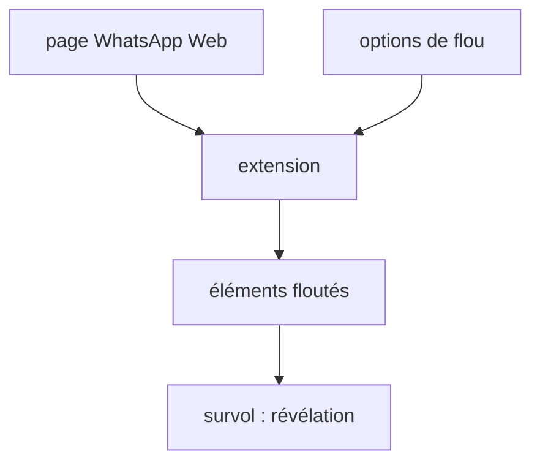

# LukasLen/Privacy-Extension-For-WhatsApp-Web

> Extension de navigateur qui floute les messages de WhatsApp Web jusqu'au survol de la souris.

## Le problème
Lire ses messages dans un lieu public expose son contenu à des regards indiscrets.

## Ce que ça fait vraiment
Floute messages, aperçus, médias, photos de profil et noms, au choix. Ils se révèlent au survol ; raccourci Alt+X pour tout basculer. Disponible sur Chrome et Firefox ; le README précise ne rien collecter de tes messages, sauf des informations de problème ou de mise à jour via son serveur.

## Comment c'est branché
Schéma simplifié d'après la fiche, sans diagramme fourni.

## Essayer
Installation par les boutiques Chrome et Firefox ; en développement : mode développeur, « Load Unpacked » sur le dossier /src.

## Coût et pièges
Le README annonce que le projet n'est plus maintenu (dépôt archivé) au profit d'un autre dépôt. L'extension contacte un serveur pour des notices.

## Ce que ce n'est pas
Pas un chiffrement ni une protection des données : un simple effet visuel.

## Alternatives
privacy-whatsapp-web-auto-blur : suite du développement, citée dans le README.

## Pour toi
À ignorer : archivée et sans rapport avec ton métier.

